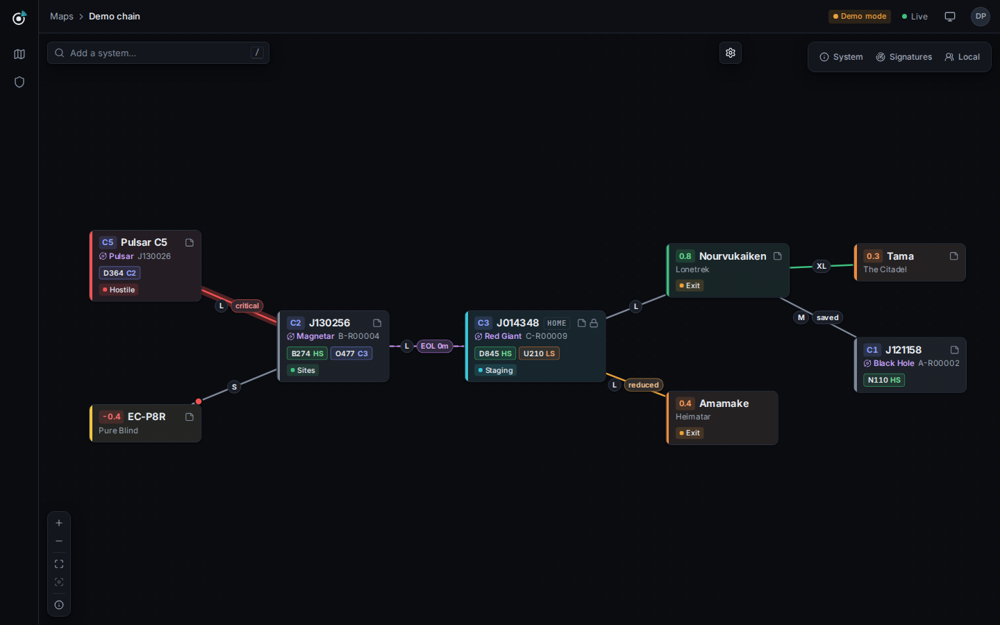

<p align="center">
  <picture>
    <source media="(prefers-color-scheme: dark)" srcset="docs/brand/mark-dark.svg">
    
  </picture>
</p>

# Darkbeacon



A self-hosted wormhole and chain mapper for EVE Online. One container, one login (EVE Online or Discord),
every EVE character of a pilot on one account, and every change streamed live to everyone looking at the
map, and to Discord.

The engineering contract is [`docs/SPEC.md`](docs/SPEC.md); choices the spec leaves open are logged in
[`docs/decisions.md`](docs/decisions.md).

## Quick start

```sh
cp .env.example .env        # fill in PUBLIC_URL and the Discord/EVE applications
docker build -t darkbeacon .
docker run -p 3000:3000 -v dbk-data:/data --env-file .env darkbeacon
```

Open `http://localhost:3000`. The first account to sign in becomes the instance owner. Data lives in the
`/data` volume (SQLite by default; set `DATABASE_URL=postgres://...` to use Postgres). Without `SECRET_KEY`
the server generates one and keeps it in `/data/secret.key`. One container holds a whole alliance (thousands of
accounts, 600 characters tracked online, 400 people connected); [`docs/scaling.md`](docs/scaling.md) has the
measured envelope, when to switch to Postgres and how to run several replicas (`CLUSTER=postgres`).

Only an EVE application (`EVE_CLIENT_ID`, `EVE_CLIENT_SECRET`, callback `<PUBLIC_URL>/api/auth/eve/callback`)
is needed: people then sign in with any of their characters, and alts added while signed in join the same
account. With a Discord application as well, Discord becomes the way in (an admin can switch back to EVE in
Admin, Instance) and Discord roles can grant map access. A Discord bot (Admin, Instance) is optional: with
it, servers, roles and channels are picked from lists, and map notifications can post without a webhook.
`/` opens your map straight away (the one you star, the instance default, or the one you used last); every
map is under All maps in the map switcher. Discord notifications are on by default and set up per map in
its Notifications tab.

The container runs one process tree behind one port: the API server (NestJS) listens on `PORT`, answers
`/api` and `/ws` itself and starts the web app's server (Next.js) on a loopback port only it knows, passing
every other request (pages, their assets, streamed HTML) through to it. If that server stops it is restarted,
and `/api/health` answers 503 until it is back, so the container's health check covers both. Put any reverse
proxy you like in front; it must not buffer responses, or pages lose their streaming.

### Backups

On SQLite (the default) Darkbeacon backs its database up by itself: daily by default, while it runs, into
`/data/backups`, keeping the 14 newest automatic backups. Admin > Backups shows when the last one ran and
the next one runs, makes one now, downloads, deletes and restores them (from the list or an uploaded file,
after typing `RESTORE`), and sets the schedule, retention and an alert webhook for failures. Before an
update migrates the database it is backed up too. Copy backups off the server now and then (download them,
or `docker cp darkbeacon:/data/backups .`), and keep `/data/secret.key` with them: it is not in a backup.
For when the web app is not an option there is a command line:

```sh
docker exec -it darkbeacon darkbeacon backup list      # also: create, verify <file>
docker run --rm -it -v dbk-data:/data darkbeacon darkbeacon backup restore <file>   # server stopped
```

`BACKUP_SCHEDULE`, `BACKUP_RETENTION`, `BACKUP_DIR` and friends set the defaults. On PostgreSQL use
`pg_dump`. Everything else, including how a restore works, is in [`docs/backups.md`](docs/backups.md).

### Your own instance on this machine

`tools/local.sh up` builds the image and runs it with Postgres (`docker-compose.local.yml`), with
settings from `.env.local` (start from `.env.example`; set `PUBLIC_URL` and your EVE application,
whose callback is `<PUBLIC_URL>/api/auth/eve/callback`). The first account that signs in owns the
instance. `tools/local.sh logs` follows the log, `tools/local.sh down` stops it; data stays in
the `darkbeacon-local` volumes.

### Demo mode: a preview without Discord or EVE

```sh
docker build -t darkbeacon:dev .
docker run -d --name darkbeacon-preview -p 127.0.0.1::3000 -v darkbeacon-preview:/data \
  -e DEMO_MODE=true -e ALLOW_DEMO_MODE=true -e PUBLIC_URL=http://localhost darkbeacon:dev
docker port darkbeacon-preview 3000      # the random loopback port it landed on
```

Open that address and you are in: there is no sign-in form. With `DEMO_MODE=true` every visit without a
session is signed in as one shared **Demo pilot** account (the owner on a fresh instance) with two fake EVE
characters, and the first visit seeds a **Demo chain** map: a home C3 with both statics open, wormhole and
known-space neighbours, and connections that are end of life, reduced or critical, frigate-only, dangerous,
bubbled and a stargate, with labels and signatures. The map is seeded again only if the demo account has no
map left. Signing out shows the normal sign-in page with an "Explore the demo" button.

Anyone who can reach the instance gets in, so the server refuses `DEMO_MODE` with `NODE_ENV=production`
(the image's default) unless `ALLOW_DEMO_MODE=true` is set too. `DEV_LOGIN` and `ALLOW_DEV_LOGIN` still work as
deprecated aliases. Fake characters have no ESI token, so they can be tracked on a map but never move.
Scripts that need several people can sign in named local accounts with
`POST /api/auth/dev {"name": "...", "character": {"name": "..."}}` (demo mode only). Plugins and themes shipped
with the server are installed from Admin > Plugins and Admin > Themes. `docker rm -f darkbeacon-preview` stops
it; the `darkbeacon-preview` volume keeps the data.

### Appearance

The web app follows the computer's light or dark mode by default (and switches live when it changes); people
can pick System, Light, Dark, High contrast or an installed theme from the top bar, and the choice is kept on
their account. The very first paint is already right: the system mode comes from CSS alone, and a picked
theme is applied by a tiny script in the page head before anything shows. Fonts (Inter, JetBrains Mono) are
bundled, so nothing is loaded from a CDN.

Pages are served as a prerendered shell (the rail, the top bar, the page frame) that appears at once, while
the parts that depend on who is looking (the account, the maps list, the map, settings) stream into it. The
map opens on a snapshot read on the server and then stays live over the WebSocket.

### Install it as an app

Darkbeacon can be installed as an app from the browser, so it runs in its own window next to the EVE client
(Windows, macOS, Linux) or from the home screen on a phone. Only the web front end is installed; it still talks
to your instance. Chrome and Edge: **Help › Install app** (or the install icon in the address bar). Safari on
iPhone and iPad: Share › Add to Home Screen; Safari on macOS: File › Add to Dock (the help menu shows the
steps). The app needs the connection: its service worker caches only the build's static files and icons and
shows an offline page when there is no network; pages, the API, sign-in and the WebSocket always go to the
server. Browsers allow service workers only over HTTPS (or on `localhost`/`127.0.0.1`), so serve the instance
over HTTPS. `PWA=off` switches it all off (no manifest, and the service worker browsers installed removes
itself on their next visit); it is read at start, no rebuild needed.

### Moving from Wanderer

Groups on Wanderer bring their maps along, intel included: **All maps**, **Import from Wanderer**. Point it at
wanderer.ltd or your own Wanderer with the map's API key (or upload the file Wanderer exports), check the
preview (what comes over, what is approximated, what is left out, who gets access), and import into a new map
or merge into one you already use. Systems, connections in every state, signatures, structures, comments and
ACL members come over; the import runs on the server, is audited as "Imported from Wanderer", can run again
without duplicates and can keep pulling from Wanderer every few minutes while everyone moves. Step by step,
and what does not migrate: [docs/migrate-from-wanderer.md](docs/migrate-from-wanderer.md).

### Telemetry

Production builds send anonymous usage statistics to the Darkbeacon maintainers, so they know how many
instances and players there are and which features are used: a daily heartbeat (version, database, which
first-party plugins are on, counts of accounts, characters and maps, daily/weekly/monthly actives, sizes as
buckets) and which features were used (a route computed in outlaw mode, a connection marked EOL, the
signatures panel opened). Never names, ids, systems, maps, IPs or anything anyone types; an instance is a
random id and an account an HMAC under a secret that never leaves your database. Browser events go through
your server, which checks them against the allow-list; PostHog never runs in the browser.

Turn it off with `TELEMETRY=off` or `DO_NOT_TRACK=1`, or with the switch in Admin > Instance, where you can
also see every payload that was sent. Development and test servers never send. The exact field list, the
reasoning and the PostHog setup are in [docs/telemetry.md](docs/telemetry.md).

### Support and feedback

The help menu (the question mark at the bottom of the left rail) has **Report a problem**, **Send
feedback** and **My tickets**. They open the maintainers' support hub in a small window, where pilots sign
in as on any Darkbeacon instance, pick which of their EVE characters a ticket belongs to and follow the
answers from any instance; the help icon shows unread answers. Nothing is sent until someone presses Send, and the form lists every detail that goes
with a ticket (version, database, page kind, browser family, the last scrubbed errors), each removable; your
instance's address and the map's size only when ticked. Never map contents, system names, map addresses,
notes, IPs or emails. Tickets are personal data and never go through telemetry. Hide the entries with
`SUPPORT_HUB_URL=off`, or point them at another hub. Details, and how to run a hub:
[docs/support.md](docs/support.md).

### Observability: Grafana, OpenTelemetry, Prometheus

Traces, metrics and logs go out over OpenTelemetry as soon as an OTLP endpoint is set; nothing else to
configure, and nothing is loaded while it is off:

```sh
docker run ... -e OTEL_EXPORTER_OTLP_ENDPOINT=http://collector:4318 darkbeacon
```

A page view is one trace from the API server through the web app's server and back to the API, down to the
SQL; log lines link to their traces; metrics cover events, the outbox backlog, webhook and Discord deliveries,
ESI requests and limits, tracking polls, online characters, maps and WebSockets. For Prometheus, set
`METRICS_PROMETHEUS=true` and `METRICS_TOKEN=...` and scrape `/metrics` with that bearer token.
`docker compose -f docker-compose.observability.yml up -d --build` runs a demo instance next to Grafana's
all-in-one `grafana/otel-lgtm` with a starter dashboard. Grafana Cloud, collectors, every variable and every
metric: [docs/observability.md](docs/observability.md). Admin > Instance shows what is exported.

### API, public maps and AI agents

- **REST API** under `/api/v1` (the versioned alias of `/api`), described as OpenAPI 3.1 at
  `/api/openapi.json` and browsable at `/api/docs` on the instance (served by it, no CDN). Integrations
  authenticate with API keys: personal access tokens (Account, API keys) act as their owner and can only
  narrow what the owner may do; service keys (Admin, API access) get explicit roles. Keys have scopes per
  resource and action, on all maps or one, an optional expiry, IP allow-list, rate limit and read-only
  switch. See [`docs/api.md`](docs/api.md).
- **Public maps**: a map admin can share a read-only, live view at `/p/<token>` and choose what it shows
  (the chain and its connection status by default; signatures, notes, labels and pilots only when chosen).
  See [`docs/public-maps.md`](docs/public-maps.md).
- **AI agents**: an MCP endpoint at `/mcp` (Model Context Protocol 2026-07-28) lets Claude and other
  assistants read the chain, find routes and the way out, and, with a key that allows it, record
  signatures and connection status. Off until an admin switches it on. See [`docs/mcp.md`](docs/mcp.md).
- Threat model and mitigations: [`docs/security.md`](docs/security.md).

## Development

Node tooling never runs on the host. Everything runs in the dev container defined by
`docker-compose.dev.yml` (`dev` for commands, `postgres` for tests, `app` for the dev servers). With VS Code
you can also open the folder in the dev container (`.devcontainer/`).

```sh
dc() { docker compose -f docker-compose.dev.yml "$@"; }   # or pass -p <name> to isolate volumes

dc run --rm dev pnpm install
dc run --rm dev pnpm typecheck     # tsc -b over all packages + the web app
dc run --rm dev pnpm lint          # eslint (with import boundaries) + prettier --check
dc run --rm dev pnpm test          # vitest; DB tests run on SQLite and Postgres
dc run --rm dev pnpm test:pg       # Postgres only
dc run --rm dev pnpm build         # server/packages to dist, the web app to apps/web/.next/standalone
dc run --rm dev pnpm format        # prettier --write
dc run --rm dev pnpm --filter @darkbeacon/sde data   # rebuild universe.json and wormholes.json (~100 MB SDE download)

dc up app                          # API (watch mode) + `next dev` behind it, DEMO_MODE=true
dc port app 3000                   # the random loopback port of the app (pages, API and /ws)
```

No fixed host ports are published; `dc port` prints where the app landed. In development the API proxies
pages to `next dev` (`WEB_UPSTREAM`, hot reload included) instead of starting the built server, so the app
is reached the same way as in production: one address for pages, `/api` and `/ws`. Open it as `localhost`;
the dev server refuses hot reload from other host names.

Two checks run against a container from the outside, in the Playwright image: `tools/e2e/` (a smoke test:
prerendered shell, demo sign-in, map, a live event) and `tools/screenshots/` (every screen, light and dark).
`tools/icons/` rebuilds the favicon, the PWA icons and the marks in `docs/brand/` from the logo's geometry.

## Layout

```
apps/server            NestJS composition root: Nest modules, controllers, ws gateway, adapters, front door,
                       the MCP endpoint (src/mcp) and the API reference (modules/docs)
apps/web               Next.js app (App Router, Cache Components, React Flow, TanStack Query): routes in
                       src/app, screens in src/screens, design system in src/ui, shell in src/shell
packages/core          ids, Result, Clock, DomainEvent envelope, authorization, errors, core ports
packages/db            Kysely factory (SQLite/Postgres), Database = UnitOfWork, migrations/<module>/
packages/shared        zod DTOs, REST routes (routes.ts), WebSocket protocol, event catalogue
packages/modules/*     identity, access, mapping, tracking, notifications, plugins, routing, audit,
                       telemetry, observability, backups, sharing, publishing, api-keys, oauth, importing,
                       support
                       (domain/application/ports)
packages/plugin-sdk    plugin manifest, PluginContext, web slots
packages/theme-sdk     theme tokens, built-in themes, CSS generator
packages/sde           SDE builder and the committed datasets: universe (systems, regions, gates) and wormholes
                       (types, hull classes, ship masses, statics and effects per wormhole system)
plugins/*              first-party plugins (plugin-sdk only)
```

## Writing a module

1. **Ports and use cases** go in `packages/modules/<m>/src`. Domain code is framework-free; use cases are
   plain classes that take ports in the constructor, authorize the actor (`requireMapRole`,
   `requireAccount`), change state and append events in one transaction:

   ```ts
   await this.uow.transaction(async () => {
     await this.systems.insert(system);
     await this.events.append([
       newEvent({
         stream: mapStream(mapId),
         type: 'system.added',
         actor: actorRef(actor),
         data: system,
         occurredAt: this.clock.now(),
       }),
     ]);
   });
   ```

   Failures throw `DomainError` subclasses (`NotFoundError`, `ForbiddenError`, ...). Event payloads follow
   `EventPayloads` in `packages/shared/src/events.ts`.

2. **Migrations** go in `packages/db/migrations/<m>/0001_name.ts` (`up(db)`), using `col.*` types. No foreign
   keys into another module's tables.

3. **Adapters** (Kysely repositories, HTTP clients) go in `apps/server/src/adapters/<m>/`. Query through
   `database.db<Tables>()` so you join the caller's transaction. Test them with
   `describeEachDialect` from `@darkbeacon/db/testing`, which gives each test a fresh database on both
   SQLite and Postgres.

4. **The Nest module** goes in `apps/server/src/modules/<m>/` and is registered with one line in
   `apps/server/src/modules/index.ts`. Inject platform services with explicit tokens
   (`@Inject(EVENT_LOG)`, `@Inject(Database)`, `@Inject(APP_CONFIG)`, see `platform/tokens.ts`). Controllers
   use `nestPath(routes.x.y.path)`, `@CurrentActor()` and `ZodPipe` for bodies.

5. **Realtime**: inject `RealtimeRegistry` and, in `onModuleInit`, register stream authorizers
   (`registerStream('map', ...)`) and snapshot parts (`registerSnapshot('map', ...)`). Authentication is
   installed by identity through `ActorResolverRegistry.use(...)`.

Imports across those lines are checked by `pnpm lint` (`tools/eslint/boundaries.js`).

## Support the project

Darkbeacon is built and maintained in my spare time, for free, for everyone who lives in wormhole space.
If it saves your fleet a few jumps and you would like to say thanks, you can send ISK in game to
**`Z4NR34L`**. Every donation, however small, goes into keeping the project alive and growing.

Donations are entirely voluntary: they buy no features, no priority and no special access, and every
instance works the same whether its users donate or not. Bug reports, ideas and pull requests help just as
much.

## Credits

- Game data: EVE Online and all related material are the property of CCP hf. Systems, stargates, wormhole
  types, ship masses and wormhole system effects are built from CCP's
  [Static Data Export](https://developers.eveonline.com/static-data); live data comes from
  [ESI](https://developers.eveonline.com/api-explorer).
- Static wormholes of each wormhole system: the statics table of
  [WormholeSystems](https://github.com/WormholeSystems/WormholeSystems) (MIT, Copyright (c) 2025
  WormholeSystems), pinned to a commit in `packages/sde/src/cli.ts`; its licence ships next to the data in
  `packages/sde/data/wormholes.LICENSE`.
- Game rules (wormhole lifetimes and mass, security rounding, faction police) follow the
  [EVE University wiki](https://wiki.eveuniversity.org/); see `docs/decisions.md` for the pages used.
